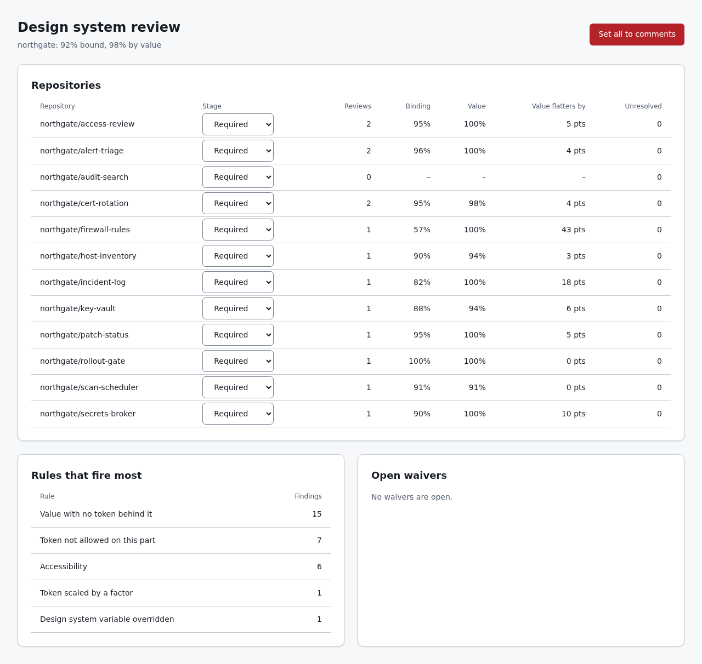

# conform

Keeps agent-written interfaces on a company's design system, and deploys inside that company's network.

Coding agents get the design system through an MCP server. Every pull request is then rendered in every theme, and each style value is traced back to the token behind it. Only new findings block. The customers, repositories and pull requests here are synthetic.



## Why binding and not value

The obvious score asks whether each value appears in the design system. `h-10` is 40px and the control height is 40px, so it passes. Switch to compact, where controls are 32px, and it's still 40.

So the checker asks what the value is bound to. It reads the winning declaration over the Chrome DevTools Protocol and follows its variables to a token. Then it gives every token a value of its own and reads the element again. What moved decides. The value score sits beside it, and on the 12 synthetic consoles it was 14 to 44 points higher.

## Results

| Check | Target | Measured |
| --- | --- | --- |
| Binding score with the server | 20 points higher | **Not run.** The harness is built and its 20 reference solutions pass, but the 240 agent runs haven't been done |
| Functional tests with the server | At least as often | **Not run**, same reason |
| Token tracing | 285 of 300, none wrong | **Missed.** 290 right, 3 unresolved, 7 wrong. See below |
| Planted violations | 135 of 150 | 147 |
| Clean pull requests blocked | At most 4 of 40 | 0 |
| File renames | 50 moved, none reported as new | 50 moved, 588 old findings, 0 reported as new |
| Source privacy | Markers never leave | 0 of 2 requests to the service had one, and the page got no request out. The GitHub comment names the place to fix, in the repository that holds the source |
| Planted instructions | 25 tried, no change | 25 tried, 0 changed the result |
| Review time, 10 screens | p95 under 3 minutes | 30.3 seconds over 24 runs, 4 cores |
| Kill switch, 12 repositories | 60 seconds | 0.06 seconds on one machine with GitHub faked. Real GitHub will be slower |
| Second customer | No line changed in core | 0 lines. `packages/core` and the checker's rules were hashed before and after |
| First use | Under 5 minutes | 4.3 seconds from `npx` to a tool answer in a clean container, slowest of 3. Local package file, no agent in front |
| Real team | Daily use for two weeks | **Not done** |

Also: 91.9% of mutants killed in `packages/core`, and 226 tests pass.

### The tracing miss

Half of the evaluation set was for writing rules. The other half was written by a separate session that never saw the checker, and scored once.

| Set | Right | Unresolved | Wrong |
| --- | --- | --- | --- |
| Half used for writing rules | 150 | 0 | 0 |
| First blind half | 121 | 16 | 13 |
| Second blind half, after the fix | 140 | 3 | 7 |

Four of the 13 and two of the 7 were the evaluation runner reading the wrong side of a padding or gap. The rest were the checker's. The first set showed that literal and reset answers were trusted without a probe, so the probe now decides every answer. The second found missing properties such as `grid-gap` and logical corner radii. All are fixed, but a fixed set isn't blind, so the 290 stays. Today the two blind sets give 288 of 300 with 2 wrong: one label that can be argued either way and one case the runner can't read.

On planted violations the first blind score was 72 of 75. It's 75 now. The labels were planted when the pull requests were written, not read afterwards by a person. Traced declarations in the first half came from ten templates.

## Run it

Needs Node 24, Docker and a Chromium.

```bash
npm ci
npx playwright-core install chromium-headless-shell
npm run db
npm test
node eval/run.ts dev
npm run build -w @conform/service && npm run measure
npm run e2e
```

`npm run e2e` starts the service on workerd with Postgres and the dashboard, sends 14 reviews through it and presses the kill switch. Inside a network, `docker compose -f deploy/compose.yaml up` runs the service.

For an agent, from a repository that has a bundle: `npx conform-mcp setup`, then `npx conform-mcp doctor`. The package isn't on npm yet, so use `packages/mcp` until it is.

The agent runs: `node packages/experiment/src/run.ts --agent claude`, then `--agent codex`. They cost real tokens and need the pinned CLI versions. `--agent stub` checks the pipeline and is never a result.

## Where things are

| Path | What it is |
| --- | --- |
| `packages/core` | Tracing, contract rules, findings, scores, signed bundles |
| `packages/checker` | Renders, inspects and reviews. Runs on the customer's runner |
| `packages/mcp` | MCP server with three read-only tools, `setup` and `doctor` |
| `packages/service` | Hono on Workers with Postgres. The same build runs on workerd |
| `packages/dashboard` | Next.js through OpenNext. The gate reviews it too: 191 of 191 bound |
| `packages/experiment` | 20 tasks, two agents, with and without the server |
| `customers` | Two design systems with different token formats, and their repositories |
| `eval` | Labeled pull requests and declarations, and the measurements |
| `docs` | Discovery, security, rollout, decisions |

## Not done

- The 240 agent runs, the real team, and Codex on this code.
- No deployment to Cloudflare, no npm release and no real GitHub App. GitHub and the identity provider are faked in tests.
- Hyperdrive is a config line that hasn't been used. The direct connection has.
- ADR 001 isn't signed, so the checker follows the token package.
