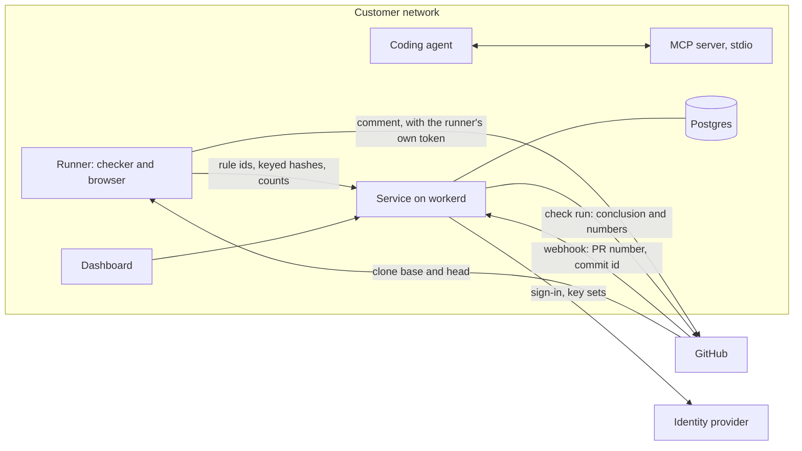

# Data flow

| Data | Where it goes |
| --- | --- |
| Source code, class names, file names, screen names | Runner and the customer's own GitHub. Never the service |
| Rule ids, property names in waiver counts, HMAC-SHA256 hashes, counts | Service |
| HMAC key | Runner only. Without it a short string can't be guessed back from its hash |
| Repository name, PR number, commit id | Service, because a check run needs them |
| Person's subject id and admin flag | Service, for the length of a session |

The service's report schema is strict. A field that could hold text is refused with a 400, and a test sends several.
